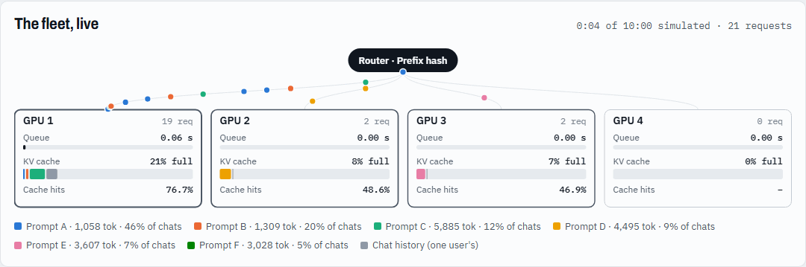

# KV Router Lab

An interactive simulator of **cache-aware routing for LLM serving**: how a router should spread requests across GPU replicas so that each replica's prefix (KV) cache actually gets reused, without overloading any one of them.

**▶ Live demo:** https://Arraj2611.github.io/kv-router-lab/



> This is a **simulation**. It models queues, prefill time and KV-cache eviction with simple arithmetic and runs on your CPU. It does not use a GPU or run a real model.

## Why it matters

LLM serving engines like vLLM and SGLang reuse the KV cache of a shared prompt prefix (system prompt, tools, chat history) instead of recomputing it. That cache lives on one GPU, so with several replicas the **router decides whether caching pays off**:

- Ignore the cache (round-robin) and every replica recomputes the same prefixes.
- Pin each prefix to one replica (prefix hashing) and the most popular prompt overloads its replica.
- Score replicas on *prefill saved vs. queue wait* and you get both high reuse and even load.

The lab lets you watch all three happen.

## Run it

**In the browser (no install):** open `index.html` in any modern browser, or use the live demo link above.

**Python CLI (no dependencies, Python 3.9+):**

```bash
python sim/cache_router_sim.py                    # 4 replicas, 6 / 14 / 20 req/s
python sim/cache_router_sim.py --replicas 8 --rates 10,30 --csv results.csv
python sim/cache_router_sim.py --help             # every knob
```

The browser engine is a JavaScript port of the Python simulator and produces the same strategy ranking.

## Strategies

| Strategy | How it picks a replica |
| --- | --- |
| Round-robin | Next replica in turn |
| Least-loaded | Shortest prefill queue |
| Sticky session | Consistent hash of the user's session |
| Prefix hash | Consistent hash of the first prompt block (≈ the system prompt) |
| Approximate prefix tree | Remembers where it sent each prefix; follows the longest match unless that replica is overloaded (similar to SGLang's router). Never sees evictions. |
| KV-aware cost | Reads each replica's real cache; picks the lowest estimated time to first token = uncached prefill + queue wait (similar to NVIDIA Dynamo / llm-d) |

## Results (Python CLI, seed 7, 4 replicas, 60k-token cache each, 20 req/s)

| Strategy | Cache hits | TTFT p50 | TTFT p99 | Load imbalance |
| --- | --- | --- | --- | --- |
| Round-robin | 63.1% | 1.26 s | 16.99 s | 1.01× |
| Least-loaded | 63.0% | 0.76 s | 11.86 s | 1.04× |
| Sticky session | 69.3% | 0.64 s | 10.84 s | 1.11× |
| Prefix hash | 70.8% | 432.5 s | 1414.3 s | 3.54× |
| Approximate prefix tree | 69.2% | 0.41 s | 2.55 s | 1.10× |
| **KV-aware cost** | **70.9%** | **0.23 s** | **1.06 s** | 1.11× |

Full numbers for three load levels are in [`sim/results.csv`](sim/results.csv).

## How the model works

- Prompts are split into 16-token blocks with chained identities, as in vLLM: a block counts as cached only if every block before it is cached.
- Each replica runs prefill one request at a time and evicts least-recently-used blocks, leaves before shared prefixes.
- Workload: six system prompts with Zipf popularity (one hot product) and multi-turn chats that grow every turn.
- Time to first token = queueing delay + prefill time. Prefill time = `overhead + uncached_tokens / prefill_tps + cached_tokens / cached_tps`. The last term is the cost of attending over an already-cached prefix; it defaults to 0 (cached tokens free), which is what the table above uses. Decoding is not modelled.

## Calibration

The default constants (`--prefill-tps 8000 --overhead 0.02`) were guesses. I measured the real thing once, on one machine, and shipped the result as opt-in profiles: `--profile rtx4070-qwen1.5b-vllm` or `--profile rtx4070-qwen1.5b-sglang`. The simulator is still a simulation; these profiles only set its per-replica cost constants.

**What was measured.** RTX 4070 Laptop GPU (8 GB), driver 617.14, WSL2 Ubuntu 22.04, `Qwen/Qwen2.5-1.5B-Instruct` in fp16 (not Llama-3.2-1B: the gated repo was not accessible), 8192 context, vLLM 0.31.0 and SGLang 0.5.22, 2026-10-16. Requests used `max_tokens=1`, so TTFT is prefill time. One request at a time unless stated.
- *Cold sweep:* unique prompts of 212 to 4,734 tokens, run in shuffled order (a cache miss).
- *Hit sweep:* a cached prefix of 400 to 4,720 tokens plus a ~30-token unique tail (a cache hit).
- *Held out, not used to fit:* a 2.4k-token shared-prefix run, and a paired run that alternates a hit with a matched-length miss.

Scripts and raw CSVs are in [`bench/`](bench/); `python bench/fit_profile.py <csv>` reproduces the constants.

| | vLLM 0.31.0 | SGLang 0.5.22 |
|---|---|---|
| Fixed cost per request | 17.7 ms | 19.7 ms |
| Prefill speed | 11,585 tok/s | 11,090 tok/s |
| Cost of a cached token | 4.0 µs (≈249k tok/s) | 3.4 µs (≈293k tok/s) |
| Fit error on the sweeps (median / worst point) | 4.2% / 10.5% | 8.2% / 16.9% |
| 2.4k-token cache hit, measured p50 | 32.6 ms | 32.1 ms |
| 2.4k-token cache hit, model | 30.6 ms (-6%) | 30.2 ms (-6%) |
| 2.4k-token miss in the paired run, measured p50 | 255 ms | 436 ms |
| 2.4k-token miss, model | 224 ms (-12%) | 235 ms (-46%) |

**Stated error.** For one request at a time, the calibrated model's median error on the length sweeps is 4–8% (worst single point 11–17%), and it is about 6% low on a 2.4k-token cache hit. When cache hits and misses alternate, it under-predicts by 12–46% on a miss and 26–38% on a hit. The cause is that TTFT on this laptop GPU is bimodal: the same 2.4k-token prompt takes about 230 ms or about 450 ms, and the slow mode shows up more in some runs than in others (a repeat of the SGLang paired run gave a 328 ms miss instead of 436 ms). The driver reported a software power cap during a third of the sampled intervals, which fits a power-limited laptop GPU, but SM clocks stayed high and I did not isolate the cause. Treat the constants as medians with roughly ±30% run-to-run spread.

**What it changed.** Without a cached-token cost the model said caching speeds up a 2.4k-token prompt about 26x; vLLM measured about 6x (255 ms to 41 ms in the paired run). With the third term the model gives 7x on a quiet GPU, which is the case the constants were fit on. Under the measured profiles, kv-aware cost is still best and prefix-hash still worst by p99 TTFT at 6, 14 and 20 req/s; the four strategies in between change order.

**What it does not cover.** One model, one GPU, two engines at default settings plus `--enable-cache-report` on SGLang. Concurrent-load throughput varied too much between runs to report (vLLM p50 at 8 clients ranged from 70 to 215 ms), so batching is still not modelled and queue lengths near saturation remain unvalidated. The vLLM runs used the PyTorch sampler instead of FlashInfer's because the CUDA toolkit was not installed at the time; at `max_tokens=1` that should not affect prefill, but it is a difference from a default install.

## Limits

- **No batching.** Queues grow faster than on a real engine near saturation. Trust the ranking of strategies more than the absolute seconds.
- Cost constants are measured on one laptop GPU and one small model (see Calibration). The built-in defaults are still guesses.
- No cache offload tier, no replica failures; the approximate router never forgets what it routed.

## Roadmap

See [`docs/ROADMAP.md`](docs/ROADMAP.md). Next up: batching-aware prefill, checked against the measurements above.

## License

MIT
